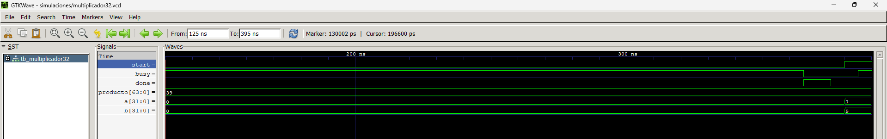
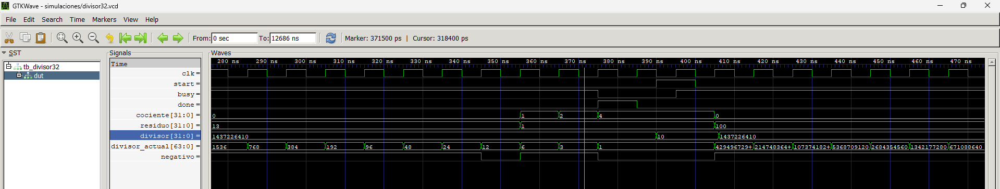
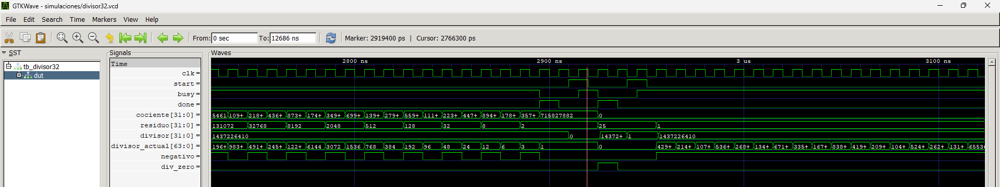

# Proyecto Corto 02 — Diseño de Sistemas Digitales

**Instituto Tecnológico de Costa Rica**  
Escuela de Ingeniería Electrónica  
Curso: EL-3310 Diseño de Sistemas Digitales

## Integrantes

- Palencia Molina Josue Adonay
- Chaverri Vargas Fabian Andres
- Bogantes Duran Kevin Isaac

## 1. Descripción del proyecto

El proyecto consiste en implementar un multiplicador y un divisor de 32 bits utilizando SystemVerilog, siguiendo las arquitecturas descritas en el capítulo 3 del libro *Computer Organization and Design RISC-V Edition*, de Patterson y Hennessy.

Los diseños se desarrollaron de manera modular y se verificaron mediante bancos de pruebas y simulaciones de ondas.

Se siguió una metodología de diseño asistido por inteligencia artificial, incluyendo especificación funcional, definición de arquitectura, implementación incremental y verificación.

## 2. Multiplicador de 32 bits

El multiplicador recibe dos operandos sin signo de 32 bits y genera un producto de 64 bits.

Utiliza el algoritmo de multiplicación mediante sumas y desplazamientos.

### Características

- Dos operandos de 32 bits.
- Producto de 64 bits.
- Procesamiento secuencial de 32 iteraciones.
- Registro del multiplicando de 64 bits.
- Registro del multiplicador de 32 bits.
- Sumador de 64 bits.
- Registro del producto acumulado.
- Unidad de control mediante máquina de estados.
- Señales `start`, `busy` y `done`.

### Módulo principal

`rtl/multiplicador/multiplicador32.sv`

### Verificación

`tb/multiplicador/tb_multiplicador32.sv`

Se realizaron 6 pruebas funcionales, incluyendo multiplicaciones por cero, por uno y operaciones con valores máximos de 32 bits.

**Resultado: 6 pruebas superadas.**

## 3. Divisor de 32 bits

El divisor recibe un dividendo y un divisor sin signo de 32 bits y produce un cociente y un residuo de 32 bits.

Utiliza un algoritmo de división con restauración basado en restas y desplazamientos.

### Características

- Dividendo y divisor de 32 bits.
- Cociente y residuo de 32 bits.
- Procesamiento secuencial de 33 iteraciones.
- Registro del divisor de 64 bits.
- Registro del residuo de 64 bits.
- Registro del cociente de 32 bits.
- ALU de resta de 64 bits.
- Unidad de control mediante máquina de estados.
- Señales `start`, `busy`, `done` y `div_zero`.

### División entre cero

Cuando se detecta una división entre cero, el circuito activa `div_zero`, devuelve cociente cero y conserva el dividendo como residuo, según la convención definida para este diseño.

### Módulo principal

`rtl/divisor/divisor32.sv`

### Verificación

`tb/divisor/tb_divisor32.sv`

Se realizaron 37 pruebas funcionales, incluyendo casos normales, casos límite, divisiones entre cero y operandos aleatorios.

**Resultado: 37 pruebas superadas.**

## 4. Herramientas utilizadas

- Visual Studio Code.
- SystemVerilog.
- Icarus Verilog 12.0.
- GTKWave 3.3.100.
- Windows y PowerShell.
- GitHub para control de versiones.

## 5. Compilación y simulación

Los siguientes comandos deben ejecutarse desde la carpeta principal del proyecto.

### Multiplicador

Compilar:

```powershell
iverilog -g2012 -s tb_multiplicador32 -o simulaciones/multiplicador32.vvp rtl/multiplicador/*.sv tb/multiplicador/tb_multiplicador32.sv
```

Ejecutar:

```powershell
vvp simulaciones/multiplicador32.vvp
```

Visualizar ondas:

```powershell
gtkwave simulaciones/multiplicador32.vcd
```

### Divisor

Compilar:

```powershell
iverilog -g2012 -s tb_divisor32 -o simulaciones/divisor32.vvp rtl/divisor/*.sv tb/divisor/tb_divisor32.sv
```

Ejecutar:

```powershell
vvp simulaciones/divisor32.vvp
```

Visualizar ondas:

```powershell
gtkwave simulaciones/divisor32.vcd
```

Los archivos VCD se generan al ejecutar las simulaciones.

## 6. Resultados

| Circuito | Pruebas | Resultado |
|---|---:|---|
| Multiplicador | 6 | Superadas |
| Divisor | 37 | Superadas |
| Total | 43 | Superadas |

Las pruebas verifican los resultados matemáticos, las señales de control y el procesamiento secuencial.

Las simulaciones permiten observar el comportamiento de los registros, las operaciones intermedias y la finalización de cada cálculo.

## 7. Documentación

La carpeta `docs` contiene:

- `especificacion.md`: requisitos y comportamiento esperado.
- `arquitectura_multiplicador.md`: arquitectura del multiplicador.
- `arquitectura_divisor.md`: arquitectura del divisor.
- `verificacion.md`: pruebas y análisis de resultados.
- `evidencias/`: capturas de las simulaciones realizadas con GTKWave.

## 8. Evidencias de simulación

### Multiplicador



### Divisor



### División entre cero



## 9. Conclusiones

Se implementaron y simularon un multiplicador y un divisor secuenciales de 32 bits utilizando SystemVerilog.

El diseño modular permitió verificar individualmente los componentes antes de integrarlos.

Las pruebas funcionales y las formas de onda muestran que ambos diseños cumplen los casos evaluados, incluyendo operaciones con valores grandes y condiciones especiales.

El proyecto evidencia la implementación de operaciones aritméticas mediante registros, ALU, desplazamientos y unidades de control.